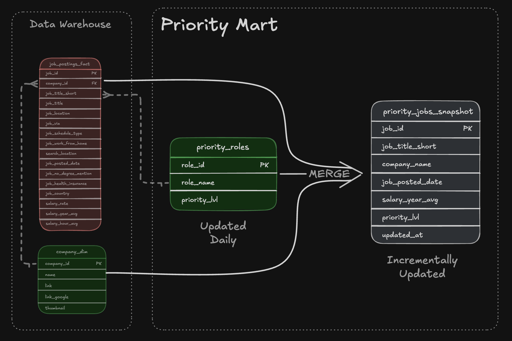

# 🏗️ Job Market Analytics – Data Warehouse & Data Marts

## Overview

This project implements a data warehouse using **DuckDB** to analyze job market trends, focusing on job postings, salary information, and in-demand technical skills.

The goal is to transform raw job market data into structured analytical datasets that support different business questions, such as:

- Which technical skills are most frequently requested by employers?
- How does skill demand evolve over time?
- What are the salary trends across different job roles?
- Which job opportunities should receive higher priority based on predefined business rules?

The project follows a dimensional modeling approach and organizes analytical datasets into specialized data marts, making the data easier to query and analyze.

## Tech Stack

| Technology | Purpose |
|---|---|
| SQL | Data transformation and warehouse development |
| DuckDB | Analytical database and SQL execution engine |
| Data Model | Star schema (fact + dimension + bridge tables) |
| Google Cloud Storage | Source CSV data storage |
| MotherDuck | Optional cloud-hosted DuckDB environment |
| Automation | Master SQL script for pipeline orchestration |
| Git / GitHub | Version control and project documentation |

## Architecture

The project follows a multi-layer data architecture:


### 1. Data Warehouse

The warehouse serves as the central storage layer, organizing the source data into relational tables using a Star Schema.

**Core tables:**

| Table | Description |
|---|---|
| `job_postings_fact` | Central fact table containing job posting information, including location, salary, schedule, and posting date. |
| `company_dim` | Company information associated with job postings. |
| `skills_dim` | Technical and professional skills, including their categories. |
| `skills_job_dim` | Bridge table connecting job postings with their required skills. |

The relationships between these tables allow job postings to be analyzed by company and required skills.


### 2. Flat Mart

Schema: `flat_mart`

The Flat Mart creates a denormalized analytical table by combining job postings, company information, and associated skills.

**Main table:**

- `flat_mart.job_postings`

Key characteristics:
- Combines job posting and company information.
- Aggregates associated skills into a structured array.
- Includes skill names and their corresponding categories.
- Provides a simplified dataset for downstream analytical queries.


### 3. Skills Mart

Schema: `skills_mart`

This data mart focuses on understanding skill demand and how it changes over time.

**Tables:**

| Table | Description |
|---|---|
| `dim_skills` | Skill identifiers, names, and categories. |
| `dim_date_month` | Monthly date dimension with year, month, and quarter attributes. |
| `fact_skill_demand_monthly` | Aggregated monthly skill demand by job title. |

The monthly fact table includes:

- `postings_count`: Number of job postings requesting a particular skill.
- `remote_posting_count`: Number of remote job postings.
- `health_insurance_posting_count`: Number of postings mentioning health insurance.
- `no_degree_mention_posting_count`: Number of postings that do not mention a degree requirement.

The data is aggregated by:

- Skill
- Posting month
- Job title

This structure supports time-series analysis and comparisons of skill demand across different job roles.


### 4. Priority Mart

Schema: `priority_mart`

This mart implements a business-rule-driven approach to prioritizing job opportunities.

**Tables:**

| Table | Description |
|---|---|
| `priority_roles` | Defines job roles and their corresponding priority levels. |
| `priority_jobs_snapshot` | Stores job postings matching the configured roles, including salary, company, posting date, and priority level. |

The initial implementation assigns priority levels to selected roles. These rules can subsequently be updated as business requirements change.

The update process uses:

- Temporary tables to prepare the source dataset.
- `MERGE` statements to synchronize the target snapshot.
- Conditional updates when priority levels change.
- Inserts for newly matching job postings.
- Deletes for records that no longer match the source dataset.

This demonstrates a SQL-based data synchronization pattern.



## Project Structure

```text
.
├── 01_create_tables_dw.sql
├── 02_load_schema_dw.sql
├── 03_create_flat_mart.sql
├── 04_create_skills_mart.sql
├── 05_create_priority_mart.sql
├── 06_update_priority_mart.sql
└── build_dw_marts.sql
```

### SQL Execution Workflow

| Script | Responsibility |
|---|---|
| `01_create_tables_dw.sql` | Creates the warehouse tables and relationships. |
| `02_load_schema_dw.sql` | Loads source CSV files from Google Cloud Storage and performs basic validation. |
| `03_create_flat_mart.sql` | Creates the Flat Mart. |
| `04_create_skills_mart.sql` | Creates the Skills Mart and monthly skill demand fact table. |
| `05_create_priority_mart.sql` | Creates the Priority Mart and initial job snapshot. |
| `06_update_priority_mart.sql` | Updates business priorities and synchronizes the job snapshot. |
| `build_dw_marts.sql` | Orchestrates the execution of all scripts. |

## Key Data Engineering Concepts Demonstrated

This project applies several foundational Data Engineering concepts:

- **Data Ingestion:** Loading structured CSV datasets from Google Cloud Storage.
- **Data Warehouse Design:** Organizing relational data using a Star Schema.
- **Dimensional Modeling:** Implementing fact tables, dimension tables, and bridge tables.
- **Data Transformation:** Using SQL joins, aggregations, CTEs, and conditional expressions.
- **Data Mart Development:** Creating specialized analytical datasets for different business requirements.
- **Temporal Aggregation:** Analyzing skill demand at a monthly level.
- **Data Validation:** Performing record counts and sample-based checks.
- **Data Synchronization:** Using temporary tables and `MERGE` statements to maintain an updated snapshot.
- **SQL Orchestration:** Automating the execution sequence through a master SQL script.

## Author

**Nicolas Imbachi**

Aspiring Data Engineer
